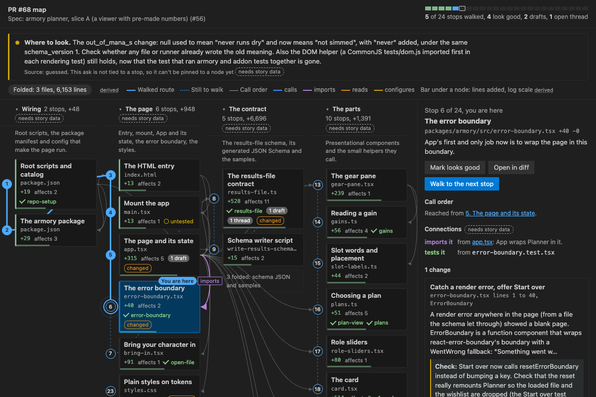
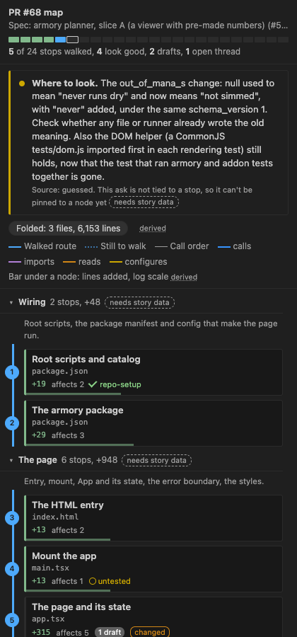
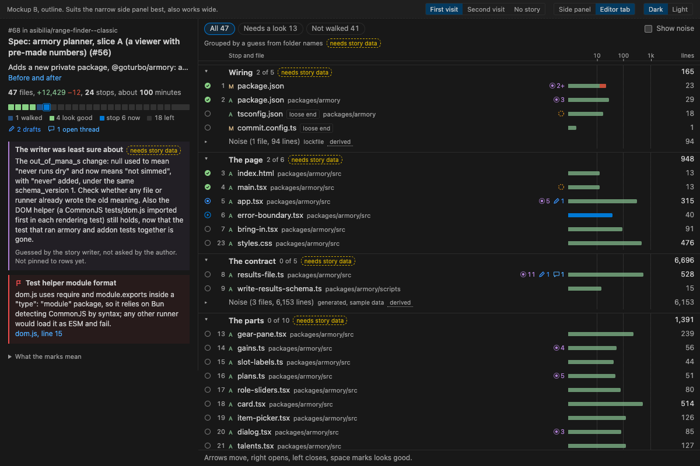
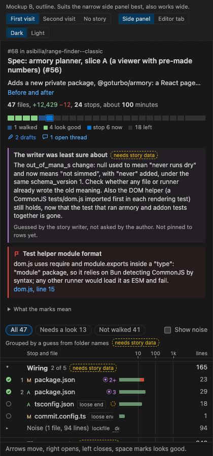
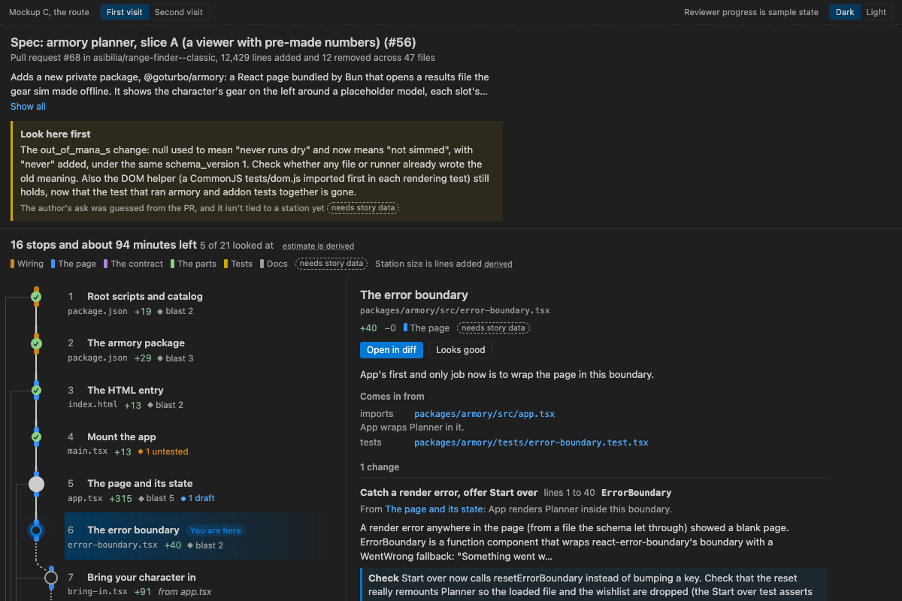
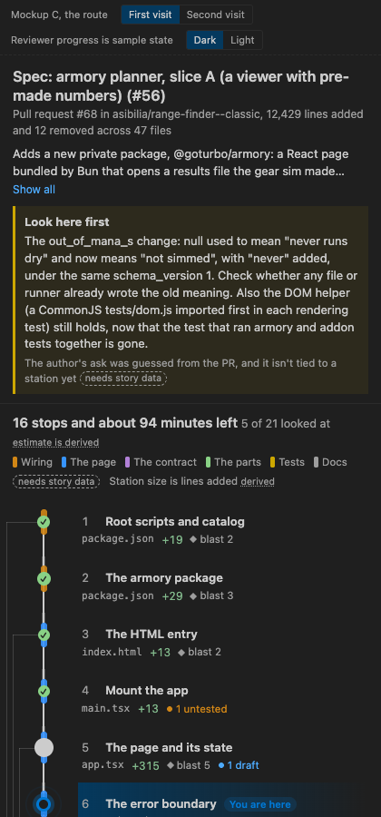
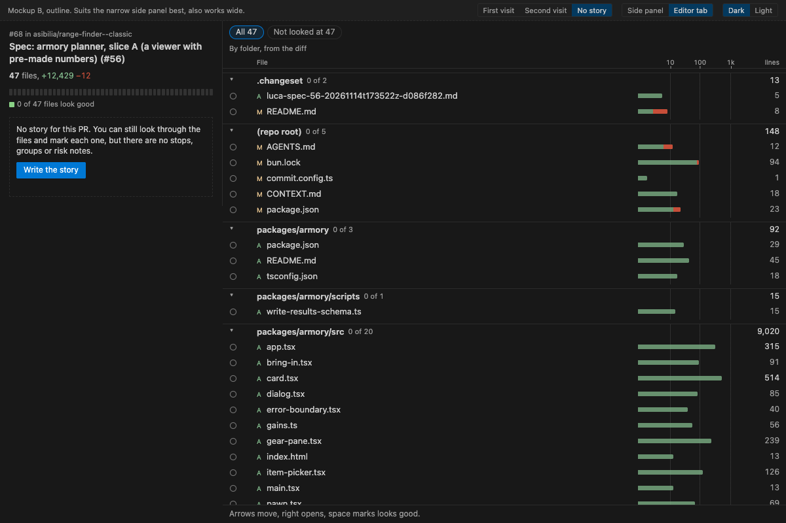
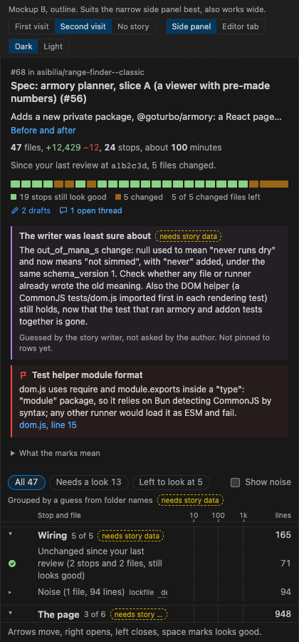

# Luca Walk: Map mockups

Three throwaway mockups of Luca Walk's **Map** panel (`packages/walk/src/map-html.ts`), built after the owner's first real review with Walk, on `asibilia/range-finder--classic` PR #68: "This is really just a list of files and a summary."

They are static HTML. No product code changed. Every file name, title, check, flag and count in them comes from PR #68's real story (and its diff). Only the reviewer's progress (walked stops, looks-good marks, drafts, threads, and which files changed for the second visit) is sample state.

## Open them

Open any of the three in a browser. Each is one file with everything inside, and works offline.

- [`a-flow.html`](a-flow.html): best in a wide editor tab (~1200 px)
- [`b-outline.html`](b-outline.html): best in a narrow side panel (~420 px)
- [`c-route.html`](c-route.html): works in both

Each has a small dark/light switch (mockup only). Resize the window to see the narrow layout. `pr68-data.js` is the data they were built from, kept for reference; the HTML files already hold a copy.

## The three ideas

- **A. Flow**: a wiring diagram. Stops are nodes in lanes (wiring, page, contract, parts), the walk is one line threaded through them, and a node's links (calls, imports, reads, configures) light up when you pick it. Answers "how does this connect?" best.
- **B. Outline**: a dense, grouped ledger. One row per file with an aligned size bar, risk, test and comment markers, and progress. Filters for "needs a look". Also shows the **second visit** and **no story** states. Answers "what's left and what matters?" fastest.
- **C. Route**: the walk itself, as a line with stations and real branches (from the story's call-order tree), "you are here", and what's left. Also shows the **second visit**. Answers "where am I?" best.

## Screenshots

| | Wide tab (1200 px) | Side panel (420 px) |
| --- | --- | --- |
| A. Flow |  |  |
| B. Outline |  |  |
| C. Route |  |  |
| B, second visit and no story |  |  |

The files are bigger than the repo's 5,000-token limit, so `scripts/check-file-size.ts` skips `docs/mockups/`.

## What the data can support

"Now" means the story or Luca Walk already has it. "Cheap" means the extension can work it out without changing the story. "Format change" means the story schema (`StorySchema`) needs a new field.

| The owner wants | Now | Cheap to derive | Needs a format change |
| --- | --- | --- | --- |
| **How the pieces connect** | `map.links` (42 on PR #68, with kind `calls`, `imports`, `reads`, `tests`, `configures`, and a note). Each change's `how_we_got_here.from_change_id` makes the stops a real call-order tree, with branches. | Which tests cover a file (links of kind `tests`, `proof.tests`). | Data flow itself (what passes what to whom) is only in link notes as words. |
| **Groups** | Only two: walk stops vs the loose ends (`in_walk`). | A guess from paths (the mockups do this: wiring, page, contract, parts, tests, docs). | Real groups: a `map.groups` list (name, blurb, files) written by the story's writer. |
| **What matters most** | Flags (`risk`, `convention`, `cleanliness`) per change and for the PR, `check_this`, blast radius counts, untested changes (`proof.covered`), the asks each change serves (`serves`). | Rank stops by these. | The author's ask (`summary.feedback_wanted`) is one paragraph, not tied to any stop. Pinning it needs a field like `feedback_wanted.change_ids`. |
| **Size** | Each change's line range. | Lines added and removed per file, from the diff Walk already reads. | Nothing. |
| **Noise folded away** | Loose ends are already set apart. | Lockfiles by name; generated files from `linguist-generated` in `.gitattributes`, or a `configures` link that "writes the file". | Sample data and fixtures are a guess. A `noise` mark per map file (`generated`, `sample`, `lockfile`, `vendored`) makes it exact. |
| **Your progress** | Done stops and the current stop, looks-good marks (per file), drafts (per file and line), GitHub review threads, and the second visit's changed files. | Per-stop progress from the per-file marks. | Nothing. |

So four of the six work today. Groups and "the author asked to look here" need the story to say more.

## What I'd build first

1. **The outline (B), in the current panel.** It uses only data Walk has now, plus diff sizes. Size bars, risk / untested / comment markers, progress, noise folded, and the second-visit state. It fixes "just a list" with the least new code.
2. **Add `map.groups` and a `noise` mark to the story format** (bump `STORY_SCHEMA_VERSION`), and teach `/luca-pr-prep` and the run's story-writer to fill them. Until then, group by the path guess, marked as a guess.
3. **Then the route (C)** as the "where am I?" header on top of the outline, since the call-order tree already exists. The flow diagram (A) is the most work and the hardest to keep readable at 40+ files; keep it as an optional view.

## Questions for the owner

1. Should groups come from the story's writer (a format change), or is a path guess good enough?
2. Should "looks good" stay per file, or also work per change? On PR #68 the loose ends stop holds 24 files, and it only looks good once every one of them is marked.
3. The writer's "least sure about" note isn't tied to any stop. Worth a field so the map can point at it?
4. What counts as noise for you: only generated files and lockfiles, or also big sample data and test fixtures?
5. Which width do you review in: a wide tab or a side panel beside the diff? That picks between A and B as the main view.
