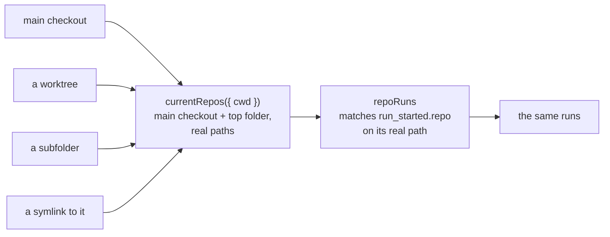

# fix(engine): /luca-unstick finds a repo's runs from a worktree (#530)

Fixes #530

## Summary



With no run id, `/luca-unstick` used `git rev-parse --show-toplevel`. In a worktree that's the worktree's own folder, but a run's `run_started.repo` is the main checkout, so it found no runs.

Now both `/luca-unstick` and `/luca-retro` look up the repo the same way:
- The main checkout: the parent of `git rev-parse --path-format=absolute --git-common-dir`, when that dir is `<checkout>/.git`.
- Then the git top folder (a worktree's own, in case a run was started there).
- Outside git: the folder itself, as before.
- A bare repo or a submodule has no `<checkout>/.git` common dir, so it adds no main checkout, only its top folder.
- Runs match on real paths (symlinks followed), so `/var` vs `/private/var` and `/tmp` vs `/private/tmp` match on macOS.

**Twin, not shared.** Each skill folder is installed to `~/.claude/skills/<name>/` on its own (`installLucaSkills`), and its script runs there with plain `bun`. A shared file (a third folder, or `../../luca-retro/...`) would break or need a non-skill folder in `~/.claude/skills`. So each script has its own `currentRepos`, with a comment naming its twin. A test pins the two as the same code (`currentRepos.toString()`), and each skill has the same behaviour test.

## Evidence

Red first. With the old lookups exported as `currentRepos`, the new test in each skill (real temp git repo, `git worktree add`, a runs dir whose journal names the main checkout):

```
(fail) finding the run > from the main checkout, a worktree, a subfolder, or a symlink, the main checkout's runs
-   "of-main",
+ []
(fail) finding the run > from the main checkout, a worktree, a subfolder, or a symlink, the main checkout's runs
-   "of-main",
+ []
 40 pass
 2 fail
```

Both failed even from the main checkout: on macOS the temp folder is `/var/...`, git says `/private/var/...`. So realpath matching was needed too, not just the main-checkout fix.

Green:
- Skill tests: 58 pass, 0 fail (`packages/engine/skills`), including the twin-identity test and a bare-repo test.
- Full engine suite (with `LUCA_RUNS_DIR` and `LUCA_BOARD_STATE_DIR` in a temp dir): 1576 pass, 0 fail.
- `bunx --bun tsc --noEmit` passes. ESLint clean on changed files.

## Merge danger

- **Door:** two-way: only the two skill helpers' run lookup changes. Revert to undo.
- **Blast radius:** small: `/luca-unstick` and `/luca-retro` with no run id. With a run id, or `--repo`, nothing changes except realpath matching. Users get it after `luca upgrade` copies the skills again.

🤖 Generated with [Claude Code](https://claude.com/claude-code)

